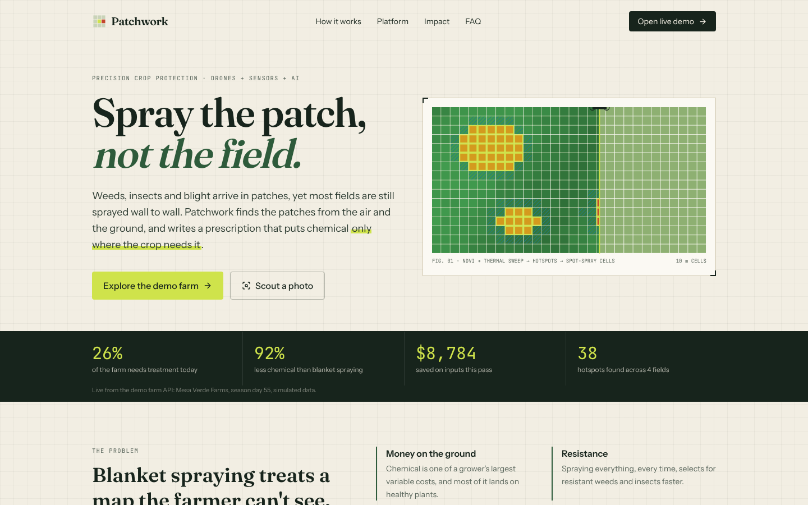
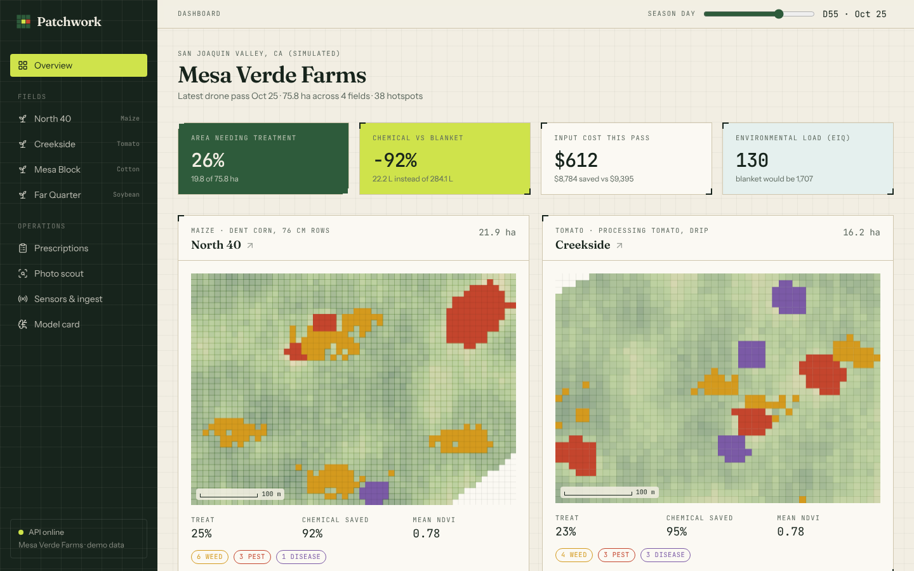
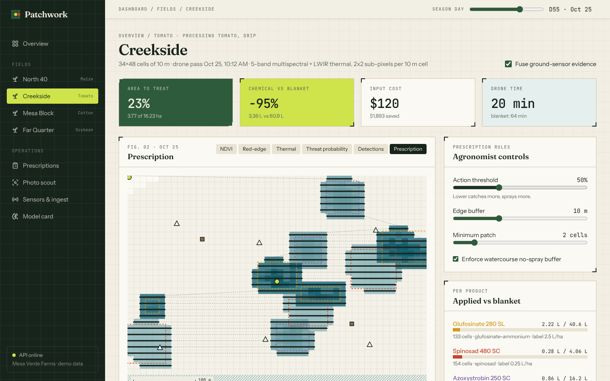

# Patchwork: spray the patch, not the field

**Drones, sensors and AI that put crop-protection chemicals only where they're needed.**

Weeds, insects and fungal disease show up in patches, but most fields are still sprayed wall to wall. Patchwork combines a multispectral and thermal drone survey with in-field sensors (pheromone traps, leaf wetness, weather, soil), finds the hotspots with a small explainable model, and turns them into a **variable-rate spot-spray prescription** and a **drone mission that flies only the rows with targets**. An agronomist tunes the rules and approves every plan before it's flown.



| Farm overview | Field workspace (prescription and flight path) |
| --- | --- |
|  |  |

On the demo farm (4 fields, 75.8 ha, season day 55) about **26% of the cropped area needs treatment, which cuts product volume by about 92%** compared with blanket-spraying every product a field needs. These numbers come from the simulator and illustrate the method. They are not field-trial results.

---

## What's in the box

| Component | Where | What it does |
| --- | --- | --- |
| **Landing page** | `frontend/src/pages/Landing.tsx` | Explains the idea, pulls live numbers from the API, FAQ, call to action |
| **Farm overview** | `/app` | KPIs, per-field threat maps, season-to-date chart of spot-spray vs blanket litres |
| **Field workspace** | `/app/fields/:id` | Map layers (NDVI, red-edge, thermal, threat probability, detections, prescription), sensor and flight-path overlays, agronomist controls, per-product volumes, drone mission, hotspot table, trap and weather panel, save/approve, GeoJSON and CSV export |
| **Prescriptions** | `/app/prescriptions` | Draft → approved → flown → archived workflow with exports |
| **Photo scout** | `/app/scout` | Upload a top-down RGB photo and get a weed map plus spray cells (no drone needed) |
| **Sensors & ingest** | `/app/telemetry` | Push readings to the live ingestion API, "simulate moth flight", recent readings |
| **Model card** | `/app/model` | Held-out metrics, confusion matrix, per-feature weights, fusion rules |
| **API** | `backend/app/main.py` | FastAPI with OpenAPI docs at `/docs` |
| **Simulator** | `backend/app/simulator.py` | Deterministic multispectral and thermal surveys, growing threat patches, sensor histories |
| **Detector** | `backend/app/detector.py` | Feature engineering, softmax classifier trained at boot, sensor fusion, hotspot extraction |
| **Prescription engine** | `backend/app/prescription.py` | Thresholds, patch filtering, edge buffers, label-rate caps, no-spray buffers, savings, EIQ, drone mission planner, GeoJSON and CSV |
| **RGB weed mapper** | `backend/app/vision_rgb.py` | Excess-green with Otsu thresholding, crop-row detection via FFT, inter-row weed segmentation |
| **Persistence** | `backend/app/store.py` | SQLite for ingested telemetry and saved prescriptions |
| **Gateway simulator** | `scripts/gateway_simulator.py` | Stdlib-only script that streams readings like a field gateway |

## Quick start

Requirements: Python 3.11+ and Node 20+.

```bash
make install     # creates .venv and installs the npm packages
make dev         # API on :8000 and web on :5173, open http://localhost:5173
```

Or with Docker (one container serves the API and the built web app):

```bash
docker compose up --build                       # http://localhost:8000
docker compose --profile sensors up --build     # plus a fake gateway streaming readings
```

Manual equivalent:

```bash
python -m venv .venv && .venv/bin/pip install -r backend/requirements-dev.txt
cd backend && ../.venv/bin/uvicorn app.main:app --reload --port 8000
cd frontend && npm install && npm run dev
```

The detector trains itself at API start-up (a few seconds) and stays in memory.

### Try the full loop in two minutes

1. Open **North 40**, switch layers from *NDVI* to *Detections* to *Prescription*, and turn on *Flight path*.
2. Move the **action threshold** and **edge buffer** and watch the litres, cost and drone time change.
3. Go to **Sensors & ingest**, pick a quiet trap on Mesa Block, press **Simulate moth flight**, then go back to the field. The pest probability around that trap goes up, and so does the insecticide plan.
4. **Save draft**, then **Approve for flight**, and download the GeoJSON.
5. Drag the **season day** slider in the header to watch patches appear and grow.

## Tests

```bash
make test        # pytest (16 tests) + vitest + TypeScript type-check
```

CI (`.github/workflows/ci.yml`) runs the backend tests and the frontend tests and build on every push and pull request.

## Product decisions (made on your behalf)

- **"Universal starter template".** The repository was empty and there's no single canonical template by that name, so I used a common modern full-stack starter layout: **Vite + React + TypeScript + Tailwind CSS** for the web app and **FastAPI** for the API, with a Makefile, Docker and CI. The visual design was deliberately moved away from the stock starter or shadcn look. It's a "field notebook" style: survey-grid paper, ink green, chartreuse marker, Fraunces serif headlines, JetBrains Mono numbers, and crop marks on cards instead of rounded shadows.
- **Name: Patchwork.** The product treats a field as a patchwork of 10 m cells, and the pitch is "spray the patch, not the field".
- **Simulated hardware, real software.** There are no physical drones or sensors here, so a deterministic simulator stands in for them. The ground truth is hidden from the model and is used only to train it and score it. Everything after the data source (feature extraction, model, fusion, prescription, mission planning, ingestion, exports) is real and can be pointed at real data.
- **Small, explainable model over a deep net.** A multinomial logistic regression over eight agronomic features trains in seconds, runs without a GPU at the field edge, and its weights are shown in the app. The interface (`predict_proba`) matches what a CNN segmentation model would expose, so a heavier model can be swapped in.
- **Sensors adjust the image model, not the other way round.** Trap counts (relative to an economic threshold of 12 per trap per day) shift pest log-odds by inverse-distance interpolation, and a leaf-wetness disease-risk index shifts disease log-odds. Live ingested trap counts override the simulated ones.
- **Safety rails are hard-coded.** Rates never exceed the label rate. Watercourse no-spray buffers are always zero unless explicitly turned off for comparison. Prescriptions are drafts until a person approves them.
- **Honest baseline.** "Blanket" means full label rate over the whole cropped area for every product the field needed in that pass. It is not compared against products it never needed.
- **Open formats.** Prescriptions export as GeoJSON (per-cell polygons with L/ha per product) and CSV (lat/lon per cell). Missions are spray-on/off waypoints.
- **Illustrative products and prices.** Glufosinate, spinosad and azoxystrobin with typical label rates, prices and Cornell EIQ values were chosen to make the economics concrete. Always follow the actual product label and local regulations.

More detail: [docs/ARCHITECTURE.md](docs/ARCHITECTURE.md) · [docs/API.md](docs/API.md) · [docs/PITCH.md](docs/PITCH.md)

## Repository layout

```
backend/            FastAPI app, simulator, detector, prescription engine, tests
frontend/           Vite + React + TS + Tailwind web app (landing + dashboard)
scripts/            gateway_simulator.py (telemetry streamer)
docs/               architecture, API reference, pitch, screenshots
Dockerfile          single-image build (web bundle served by FastAPI)
docker-compose.yml  app + optional sensor gateway
Makefile            install / dev / test / build / docker
```

## Roadmap

- Swap the simulator for real imagery (GeoTIFF orthomosaics) and a U-Net segmentation model.
- ISO-XML (ISOBUS) task export for ground sprayers, and direct upload to drone ground-control software.
- Multi-tenant auth, farm and field onboarding by drawing a boundary on a basemap.
- As-applied logs from the drone, closing the loop for compliance records.
